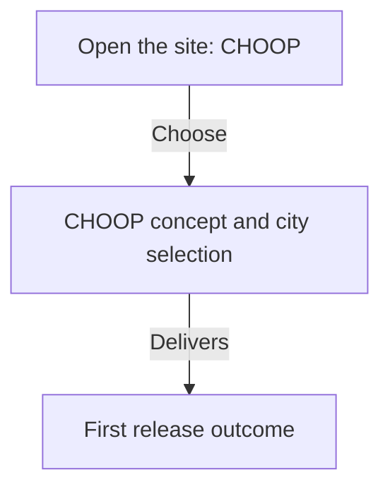
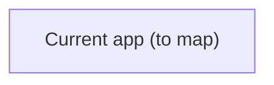
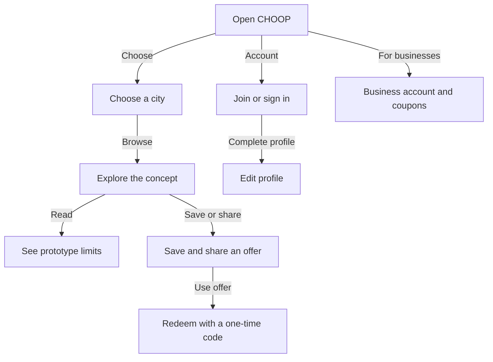
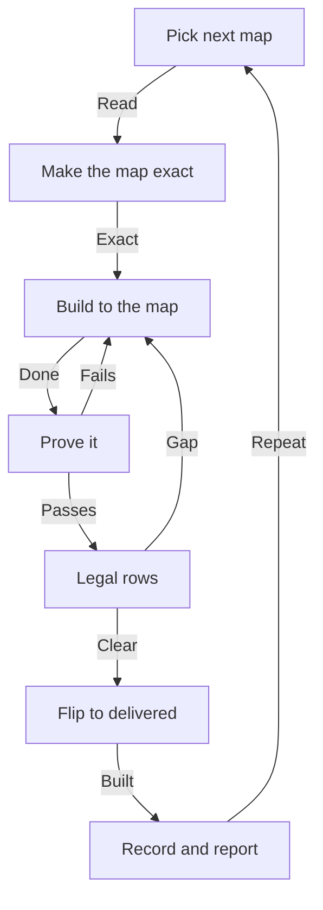
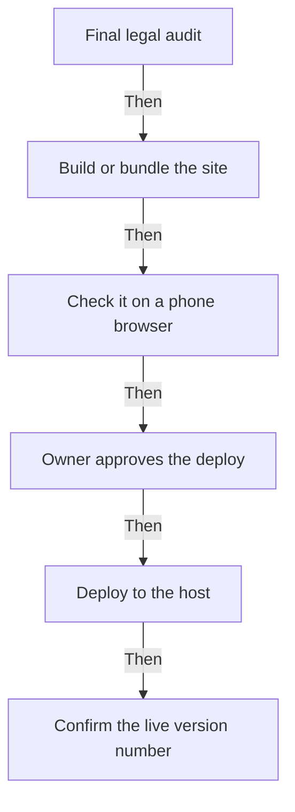

# CHOOP · Flow Atlas

Source snapshot: Local working tree (not a Git repository) · 2026-11-14.

Existing CHOOP React concept and city selection

Open [the interactive atlas](./index.html) for diagrams, step details, source references, SVG export and printing.

## Index

1. [The whole product](#overview) — planned
2. [Build order](#roadmap) — planned
3. [CHOOP concept and city selection](#current-app) — building
4. [How every feature is built](#quality-gates) — delivered
5. [Release](#release) — planned

## The whole product

Status: **planned** · CHOOP consumer-facing concept on the web. The current app map records the existing prototype.

Sources: none yet (planned).

| Step | Behaviour |
| --- | --- |
| Open the site: CHOOP | Entry point on Web app / PWA (runs in a browser). Design how a new user starts. |
| CHOOP concept and city selection | Map what already exists as delivered maps with source references. |
| First release outcome | Explore a static social savings concept; product functionality remains unconnected. |

- Existing React prototype adopted into Loop on 2026-11-14; browser proof remains outstanding.

## Build order

Status: **planned** · The order Loop builds the features in (meta.buildOrder).

Sources: none yet (planned).

| Step | Behaviour |
| --- | --- |
| Current app (to map) | Release 1. Track: .loop/tracks/current-app/spec.md |

- npm run atlas:next always names the first map in this order that is not delivered. The release map comes last.

## CHOOP concept and city selection

Status: **building** · Explore the concept, select a city, and visit supporting pages.

Sources: [src/main.jsx:14](../../src/main.jsx), [src/Home.jsx:17](../../src/Home.jsx), [src/components.jsx:18](../../src/components.jsx), [src/Catalog.jsx:37](../../src/Catalog.jsx), [src/routes.js:4](../../src/routes.js), [server/catalog.mjs:6](../../server/catalog.mjs), [server/auth.mjs:8](../../server/auth.mjs), [src/Profile.jsx:7](../../src/Profile.jsx), [server/profile.mjs:4](../../server/profile.mjs), [src/Business.jsx:9](../../src/Business.jsx), [server/business.mjs:13](../../server/business.mjs), [src/location.js:6](../../src/location.js), [src/OfferActions.jsx:3](../../src/OfferActions.jsx), [server/saved.mjs:2](../../server/saved.mjs), [server/redemption.mjs:7](../../server/redemption.mjs), [server/static.mjs:4](../../server/static.mjs), [server/preview.mjs:1](../../server/preview.mjs).

| Step | Behaviour |
| --- | --- |
| Open CHOOP | Responsive home with navigation and illustrative offers. |
| Choose a city | Native selector lists major Indian cities; default is unselected. |
| Explore the concept | Home and Explore show offers directly; category filters narrow the list before opening offer details. |
| See prototype limits | Offers, account features and newsletter remain unconnected. |
| Join or sign in | Local email/password accounts and cookie sessions; database and browser proof outstanding. |
| Edit profile | If profile city is empty, request browser location permission and suggest a nearby supported city; user can choose another and save profile. |
| Business account and coupons | Business signs up or in, creates coupon drafts and chooses whether to publish; access is limited to their own account. |
| Save and share an offer | Signed-in user saves an available offer to their account or shares its public link. |
| Redeem with a one-time code | A signed-in customer generates a short-lived code for an eligible offer; its owning business validates it once. |

- City selection is in-memory only; it does not filter offers or persist.
- Unit and production-build checks passed; browser and runtime verification blocked by environment.
- Explore image-led cards implemented; category/asset tests and build passed; runtime and visual proof remain outstanding.
- Category detail pages offer a compact link back to the category directory; example offer cards remain image-led.
- Style Deal shows sample terms, a fictional merchant and proposed redemption; claim is disabled. Build passed; browser verification pending.
- Clean directory URLs and legacy .html paths resolve to the same static React pages; route test and build passed. Database integration awaits provider and scope.
- Local MongoDB catalog and email/password accounts implemented; driver install and real database verification blocked.
- Do not mark delivered until MongoDB and browser flows are verified; account recovery and verification remain unimplemented.
- Local dev now starts API and Vite together. API startup and live MongoDB verification remain blocked here by EPERM, missing driver, and registry DNS.
- Sign-in and join password fields include a labeled show/hide toggle; browser interaction verification remains outstanding.
- API reachable but returns 503; MongoDB driver now installed; no local port 27017 listener observed. Safe connection diagnostics added; live database verification pending.
- Profile editing and a derived incomplete-profile notification implemented; fake-database authorization tests and build passed; browser and real MongoDB proof outstanding.
- Optional searchable interest tags are saved per account, limited and validated; offer matching is not yet implemented.
- Business sign-up/sign-in and owner-scoped drafts and publish/unpublish implemented; fake-database tests passed. New server routes and browser remain unverified.
- Business registration 405 traced to an old API process; combined dev command now uses Node watch. Restart once and verify live registration.
- Categories API returned an empty list; local seed attempt could not connect in sandbox. Run seed:categories on host and verify.
- Profile city autofill uses permission-based browser geolocation and local nearby-city matching; coordinates are not sent or persisted. Browser proof pending.
- Business-area header shows business-session actions rather than consumer sign-in; browser verification pending.
- Consumer and business login/register limits are separate from routine account actions; tests pass and live invalid login returned 401.
- Guest, consumer and business headers now have contextual navigation and account states. Owner clarified admin means business/merchant; no platform admin role added.
- Business category select has native styling and loading, empty and error states; browser verification pending.
- Business dashboard uses a separate workspace layout with counts from returned coupons, draft creation, and publish controls; build/tests passed, browser proof pending.
- Save and share implemented for signed-in users; unauthenticated API check and fake-database tests passed.
- Owner chose one-time code and once per user per offer. Atomic claim consumption implemented; real authenticated MongoDB and browser proof pending.
- Production blocker: offer eligibility and claim update are separate operations and can race with unpublishing; stronger rate limiting and audit are also needed.
- Home offers and Explore filters shorten discovery; offer sign-in returns to the offer and browser titles identify dynamic routes. Tests/build passed; browser verification pending.
- Explore category filters query the API by category; each response remains capped at 100 and pagination is future work.
- Offer cards use ticket styling with a discount stub and header saved icon uses SVG; browser visual proof pending.
- Offers without custom steps show generic one-time-code instructions; example offers remain non-redeemable. Consumer header uses an accessible sign-out icon and profile avatar on the right.
- Render and MongoDB Atlas read-only preview files prepared; synthetic data, static routing and policy tests supplied. No hosted deployment verified.

## How every feature is built

Status: **delivered** · The atlas-first checkpoint loop this project follows.

Sources: [AGENTS.md:1](../../AGENTS.md), [.loop/workflow.md:1](../../.loop/workflow.md), [.loop/platform.md:1](../../.loop/platform.md).

| Step | Behaviour |
| --- | --- |
| Pick next map | npm run atlas:next names the next planned map and its track. |
| Make the map exact | Steps, branches, defaults, failure paths. Status: building. |
| Build to the map | Smallest coherent change, all languages, version bump. Platform: Web app / PWA (runs in a browser). |
| Prove it | Behaviour tests (npm test (or the test command of the chosen web stack)), npm run atlas, phone-width and desktop screenshots in a real browser. Proof ladder in .loop/platform.md. |
| Legal rows | Update .loop/legal-checklist.md rows this change touches (data, cookies, APIs, packages, assets, AI content, payments, advice, claims). Rules: Loop/LEGAL-CHECKLIST.md. |
| Flip to delivered | Add source refs (file:line). The build refuses delivered without source. |
| Record and report | Track, fix queue, HANDOFF CURRENT RESUME, commit, plain-words report. |

- Defined by AGENTS.md, .loop/workflow.md and .loop/platform.md (generated by Loop).

## Release

Status: **planned** · How CHOOP reaches users on Web app / PWA (runs in a browser).

Sources: none yet (planned).

| Step | Behaviour |
| --- | --- |
| Final legal audit | Legal check 20: recheck all 20 rows in .loop/legal-checklist.md, flag lawyer items, owner approves legal pages. Rules: Loop/LEGAL-CHECKLIST.md. |
| Build or bundle the site | Release step: Build or bundle the site. Owner approval gates in Loop/loop.md apply. |
| Check it on a phone browser | Release step: Check it on a phone browser. Owner approval gates in Loop/loop.md apply. |
| Owner approves the deploy | Release step: Owner approves the deploy. Owner approval gates in Loop/loop.md apply. |
| Deploy to the host | Release step: Deploy to the host. Owner approval gates in Loop/loop.md apply. |
| Confirm the live version number | Release step: Confirm the live version number. Owner approval gates in Loop/loop.md apply. |

- Built last, after the first-release features. Track: .loop/tracks/release/spec.md

## Coverage and limitations

Planned maps describe intended behaviour and are not delivered. Delivered maps are source-reviewed; they are not proof of runtime, device or performance behaviour unless the notes say which evidence exists.
